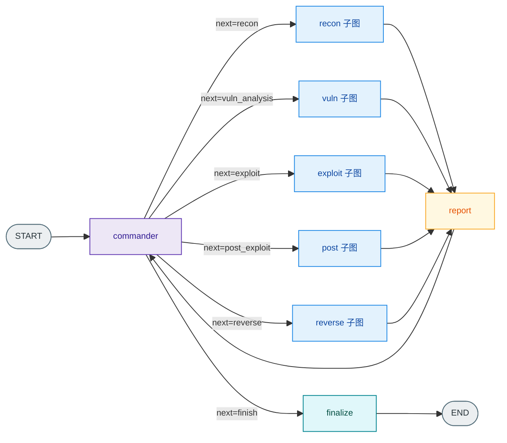
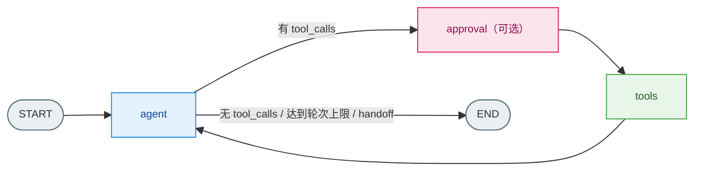
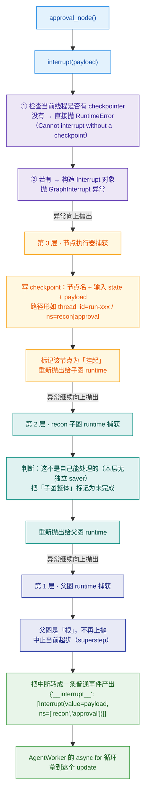
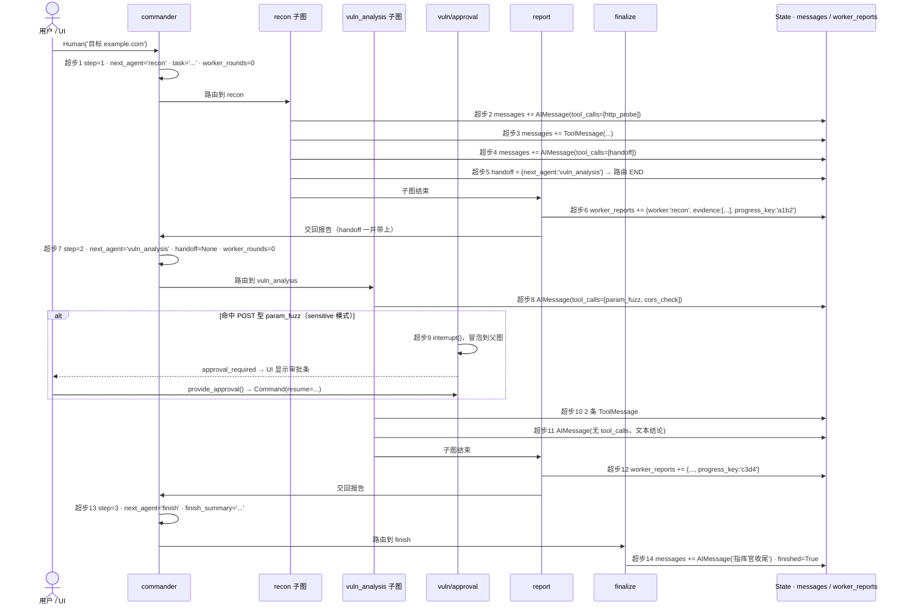
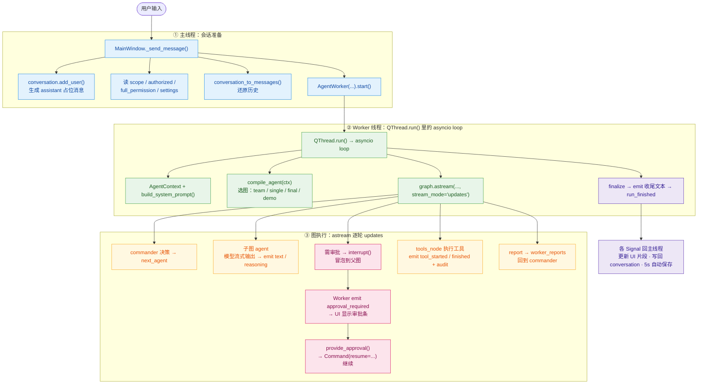
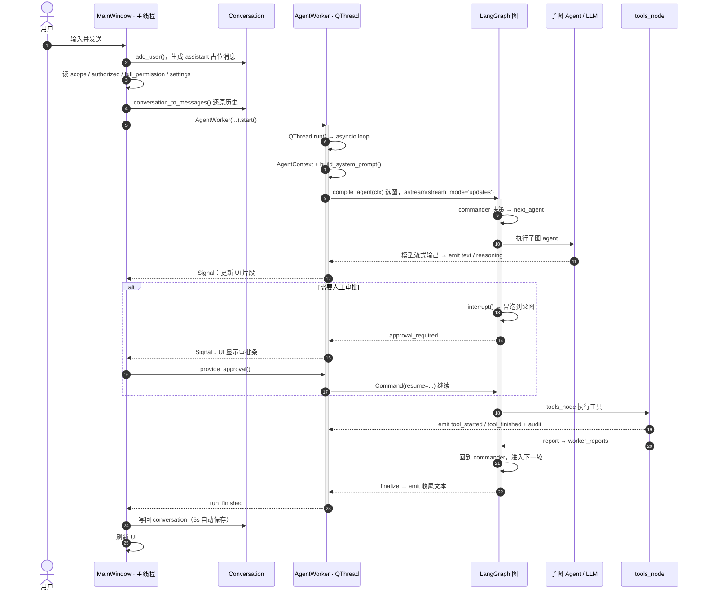

## 前言

> 本次更新未涉及到 UI 内容，主要改进了 LangGraph 架构。

本项目（SSsec v0.2.0）在 Tsecbench 平台的跑分测试结果如下：

**Tsecbench v1 ：**

综合得分 **67.03**  获得点数 **16050**  完成率 **68.9%**  答对Flag **51/74**

**排名：168 名**



获得点数提高了 2300 分，综合得分提高了 12 分，完成率接近 70% 。其实改进后的成绩我还挺满意的，**但排名却掉了 10 名**。其实从这点也可以看出攻防 Agent 方向已经有很多人在做了，短短两周不到的时间就有很多人走在了我的前面，只能说**时间紧、任务重**。

**Tsecbench v2 ：**

综合得分 **26.33**  获得点数 **8900**  完成率 **30%**  答对Flag **30/100**

**排名：6 名**



v2 试题集在我测完 v1 的第二天上线了，我也是隔了几天才测，侥幸拿了第六名（看来测的人不是很多）。现在再看好像掉到十多名了，也不用太着急，先争取把 v1 的成绩打上去。从得分来看 v2 的难度比 v1 要难非常多，是一块硬骨头。

------

## 项目简介

> **SSsec** **v0.2.0** 是一个**本地桌面 AI Agent Harness**，面向授权安全测试。
> 界面使用 **PySide6**，Agent 运行时基于 **LangGraph + LangChain**，模型服务、对话、工具调用、权限策略与审计全部围绕桌面工作流设计。

**当前版本：v0.2.0（更新了 LangGraph 架构等内容）**



------


## 技术架构

### 多 Agent 架构（Supervisor + Subgraph）

#### 为什么改成多 Agent

单 Agent 把所有工具绑在同一个模型上，容易出现三个问题：

1. 信息收集阶段直接执行利用命令，或在没有证据时开始扫描；
2. 一个长任务里所有工具结果、推理、命令输出都塞进同一条上下文，造成**上下文膨胀**；
3. 模型的职责不清，失败后难以定位是策略问题还是执行问题。

多 Agent 的目标是把**调度**与**执行**拆开，Supervisor（指挥官）只决定下一步交给谁、任务是什么、什么时候收尾；阶段子 Agent只在自己的阶段职责与工具白名单内工作，把产出压缩成可审计的中间结果，再交给指挥官。

不过多Agent架构最显著的缺点就是token消耗很高，单次任务执行时间长。相比单Agent，该架构在本次跑分过程中消耗的token量和时间是之前的几倍。（跑一次测评从之前的几块到几十，除了token消耗高，未命中缓存率也比之前高很多）

#### Commander 指挥官（Supervisor 架构）

> 指挥官（Supervisor）节点：只做路由，不执行任何工具。

**具体边界：**

| 能做                                 | 不能做                                   |
| :----------------------------------- | :--------------------------------------- |
| 读总目标、阶段报告、交接建议         | 持有任何工具（`build_tools` 从不传给它） |
| 输出 `{next, task, reason, summary}` | 直接发 HTTP / 跑命令 / 读文件            |
| 决定派谁、派什么任务、何时收尾       | 执行渗透测试动作                         |
| 消费/采纳/忽略 `handoff`             | 绕过子 Agent 直接给用户结论（收尾除外）  |

**角色声明：**

```
你是 SSsec 渗透测试小队的指挥官。**你不执行任何工具，也不直接做渗透测试。**
你的唯一职责是：根据总目标、已有证据、上一阶段报告和交接建议，
决定下一步交给哪个子 Agent，并把任务简报写清楚。
```

**子 Agent 清单：**

```python
rules = COMMANDER_RULES.format(
    recon=WORKER_DESCRIPTIONS["recon"],
    vuln=WORKER_DESCRIPTIONS["vuln_analysis"],
    exploit=WORKER_DESCRIPTIONS["exploit"],
    post=WORKER_DESCRIPTIONS["post_exploit"],
    reverse=WORKER_DESCRIPTIONS["reverse"],
)
```

**调度规则：**

|      | 规则                                                     | 解决的问题                       |
| :--- | :------------------------------------------------------- | :------------------------------- |
| 1    | 默认顺序 recon→vuln→exploit→post→finish，允许跳阶段/回退 | 避免机械按序，同时保留主线       |
| 2    | 每次只派一个 Agent；任务简报必须具体、可执行             | 防止并行导致状态竞争与上下文交叉 |
| 3    | 有 handoff 建议时优先考虑，只有证据表明不合适才改写      | 保留子 Agent 的判断力            |
| 4    | 不要重复已完成且无新输入的阶段；回退必须说明新角度       | 防循环派发                       |
| 5    | 目标达成/证据足够/无法继续/达上限 → `finish` + 简洁摘要  | 收敛条件                         |
| 6    | 普通问答不需要工具时 → 直接 `finish`，回答写进 `summary` | 闲聊/提问不触发扫描              |
| 7    | 不要为"多跑一个阶段"延长流程                             | 抑制过度执行                     |

#### 拓扑



每个阶段子图内部：




#### 角色与工具

| 角色            | 提示词关键词                         | 工具白名单（核心）                                           | 产出                                   |
| --------------- | ------------------------------------ | ------------------------------------------------------------ | -------------------------------------- |
| `commander`     | 指挥官、只路由、JSON 决策            | 无                                                           | `next`、`task`、`reason`、`summary`    |
| `recon`         | 信息收集、资产梳理                   | `http_probe`、`http_request`、`api_discover`、`port_scan`、`subdomain_enum`、`dir_scan`、`web_crawl`、`dns_zone_transfer`、`whois_lookup`、`tls_certificate` | 资产清单、候选入口、证据               |
| `vuln_analysis` | 漏洞假设、配置检查、风险排序         | `http_request`、`http_raw`、`http_upload`、`security_headers`、`param_fuzz`、`lfi_probe`、`ssrf_probe`、`api_discover`、`cors_check`、`jwt_analyze`、`waf_detect`、`artifact_scan`、`codec`、`crypto_workshop`、`binary_info`、`disassemble`、`file_analyze`、`run_command` | 候选漏洞、影响、验证建议               |
| `exploit`       | 低影响验证、证明影响后收敛           | `http_request`、`http_raw`、`http_upload`、`security_headers`、`param_fuzz`、`lfi_probe`、`ssrf_probe`、`api_discover`、`payload_forge`、`codec`、`tcp_exchange`、`binary_info`、`disassemble`、`run_command`、`workspace_write` | 验证请求/命令、响应证据、影响          |
| `post_exploit`  | 权限/影响评估、证据整理、收尾        | `run_command`、`webshell_client`、`archive_extract`、`artifact_scan`、`file_analyze`、`disassemble`、`http_request`、`http_raw`、`workspace_write` | 权限级别、影响范围、证据清单、修复建议 |
| `reverse`       | ELF/PE/固件逆向、校验逻辑            | `binary_info`、`disassemble`、`file_analyze`、`crypto_workshop`、`codec`、`run_command`、`tcp_exchange`、`archive_extract`、`artifact_scan`、`flag_hunt` | 程序结构、校验算法、求解脚本/key       |
| `final`         | 汇总全部证据、重新完整思考、最后突破 | 全部 37 个工具                                               | 最终 flag、已验证事实与剩余攻击面      |

> 所有阶段共享 `save_finding`、`handoff`、`flag_hunt`、`workspace_list`、`workspace_read`。
> `reverse` 是可被指挥官选择的专项 Agent，不进入默认四阶段顺序。
> `final` 只在 TSEC 的最终突破阶段使用，不绑定 `handoff`，也不经过指挥官。

**场景映射**

| 场景      | recon                  | vuln_analysis           | exploit                | post_exploit                   |
| --------- | ---------------------- | ----------------------- | ---------------------- | ------------------------------ |
| CTF 解题  | 指纹、端口、目录、附件 | 参数/源码/二进制/Crypto | payload、HTTP/TCP 利用 | flag 提取、证据                |
| AWD       | 服务与入口识别         | 漏洞假设                | 最小利用               | `webshell_client`、`flag_hunt` |
| SRC       | 子域/目录/爬虫扩面     | 参数/CORS/JWT/WAF       | 最小 PoC               | 影响与证据                     |
| tsecbench | 靶场地址与服务         | 入口与漏洞              | 利用拿 flag            | flag 收敛与提交前整理          |


### Checkpointer 与 interrupt 冒泡

#### Checkpointer 布局

父图：显式持有 saver

```python
saver = checkpointer or InMemorySaver()
...
return _compile_team(ctx, base_model, saver)     # 传给团队图
```

```python
return builder.compile(checkpointer=checkpointer)
```

子图：不传checkpointer

```python
worker_graphs = {
    name: compile_worker(ctx, WORKER_SPECS[name], base_model) # ← 只有 3 个位置参数
    for name in WORKER_SPECS
}
```

#### interrupt 冒泡

SSsec 的图有三层嵌套：

```
第 1 层  团队父图（StateGraph）
          节点 "recon" = 编译好的子图
              ↓
第 2 层  recon 子图（StateGraph）
          节点 "approval"
              ↓
第 3 层  approval_node 函数体
          interrupt(payload)
```

调用 `interrupt()` 时的实际执行路径：

`approval_node()` 调用 `interrupt(payload)` 后，沿着节点执行器 → 子图 runtime → 父图 runtime 逐层栈展开，最后在根节点被转译成一条普通 update 事件。



### 一次完整的多 Agent 轨迹

以「用户输入目标 → recon → vuln_analysis → finish」为例，每步都标出 state 的增量（`messages` / `worker_reports` / `handoff` / `step` / `finished`）。

#### 14 个超步的 state 演进（流程图）

```mermaid
%%{init: {"themeVariables": {"fontSize": "12px"}, "flowchart": {"curve": "basis", "nodeSpacing": 50, "rankSpacing": 40, "padding": 12, "diagramPadding": 12, "subGraphTitleMargin": {"top": 0, "bottom": 6}}}}%%
flowchart TD
    INIT(["初始 state<br/>messages = [Human('目标 example.com')]"])

    subgraph R1[" "]
        direction TB
        H1["第 1 轮 · recon 侦察"]
        S1["超步 1 · commander<br/>step=1 · next_agent='recon'<br/>task='...' · worker_rounds=0"]
        S2["超步 2 · recon/agent<br/>messages += AIMessage(tool_calls=[http_probe])"]
        S3["超步 3 · recon/tools<br/>messages += ToolMessage(...)"]
        S4["超步 4 · recon/agent<br/>messages += AIMessage(tool_calls=[handoff])"]
        S5["超步 5 · recon/tools<br/>handoff = {next_agent:'vuln_analysis', ...}<br/>路由 END"]
        S6["超步 6 · report<br/>worker_reports += {worker:'recon',<br/>evidence:[...], progress_key:'a1b2'}"]
        H1 --> S1 --> S2 --> S3 --> S4 --> S5 --> S6
    end

    subgraph R2[" "]
        direction TB
        H2["第 2 轮 · vuln_analysis 漏洞验证"]
        S7["超步 7 · commander<br/>step=2 · next_agent='vuln_analysis'<br/>handoff=None · worker_rounds=0"]
        S8["超步 8 · vuln/agent<br/>AIMessage(tool_calls=[param_fuzz, cors_check])"]
        S9{"超步 9 · vuln/approval<br/>命中敏感工具？"}
        S9A["interrupt()<br/>POST 型 param_fuzz（sensitive 模式）"]
        S9B["UI 审批条<br/>provide_approval() → Command(resume=...)"]
        S10["超步 10 · vuln/tools<br/>2 条 ToolMessage"]
        S11["超步 11 · vuln/agent<br/>AIMessage(无 tool_calls，文本结论)"]
        S12["超步 12 · report<br/>worker_reports += {..., progress_key:'c3d4'}"]
        H2 --> S7 --> S8 --> S9
        S9 -- 是 --> S9A
        S9A --> S9B
        S9B --> S10
        S9 -- 否 --> S10
        S10 --> S11 --> S12
    end

    subgraph R3[" "]
        direction TB
        H3["第 3 轮 · finish 收尾"]
        S13["超步 13 · commander<br/>step=3 · next_agent='finish'<br/>finish_summary='...'"]
        S14["超步 14 · finalize<br/>messages += AIMessage('指挥官收尾')<br/>finished=True"]
        H3 --> S13 --> S14
    end

    DONE(["终态 · finished=True"])

    INIT --> H1
    S6 -->|回到父图 commander| H2
    S12 -->|回到父图 commander| H3
    S14 --> DONE

    classDef hdr fill:#FFF9C4,stroke:#C0CA33,stroke-dasharray:3 3,color:#5D4037
    class H1,H2,H3 hdr

    classDef init fill:#ECEFF1,stroke:#546E7A,color:#263238
    classDef cmd fill:#EDE7F6,stroke:#5E35B1,color:#311B92
    classDef agent fill:#E3F2FD,stroke:#1E88E5,color:#0D47A1
    classDef tool fill:#E8F5E9,stroke:#43A047,color:#1B5E20
    classDef report fill:#FFF8E1,stroke:#F9A825,color:#E65100
    classDef ap fill:#FCE4EC,stroke:#D81B60,color:#880E4F
    classDef fin fill:#E0F7FA,stroke:#00838F,color:#004D40

    class INIT,DONE init
    class S1,S7,S13 cmd
    class S2,S4,S8,S11 agent
    class S3,S5,S10 tool
    class S6,S12 report
    class S9,S9A,S9B ap
    class S14 fin
```



#### 三个 Agent 的交互时序（序列图）




### 工具层

#### 通用核心工具（tools.py）

##### 1. http_request

| 参数       | 默认    | 说明                             |
| :--------- | :------ | :------------------------------- |
| `url`      | —       | 仅允许 http/https                |
| `method`   | `GET`   | `ALLOWED_HTTP_METHODS` 白名单    |
| `headers`  | `None`  | dict                             |
| `body`     | `None`  | 字符串                           |
| `insecure` | `False` | 跳过 TLS 校验，仅 CTF/自签名靶场 |

**行为**：发一次请求，返回状态码、响应头（截断）、响应体（截断）。

**谁用**：recon / vuln_analysis / exploit / post_exploit

##### 2. dns_lookup

| 参数          | 默认 | 说明                                                    |
| :------------ | :--- | :------------------------------------------------------ |
| `host`        | —    | 域名或 IP                                               |
| `record_type` | `A`  | `ALLOWED_DNS_TYPES`：A/AAAA/CNAME/MX/TXT/NS/SOA/CAA/PTR |

**行为**：查询单个记录类型，返回解析结果。

**谁用**：仅 `recon`。这是一个细粒度工具，与 `http_probe` 互补

##### 3. tcp_probe

| 参数         | 默认   | 说明                            |
| :----------- | :----- | :------------------------------ |
| `host`       | —      | 目标主机                        |
| `ports`      | —      | `list[int]`，**单次最多 20 个** |
| `timeout_ms` | `1200` | 连接超时                        |

**行为**：纯 TCP 连接探测，不发送应用层数据，返回 `open` / `closed` / `timeout` 三态。

##### 4. run_command

| 参数      | 默认 | 说明     |
| :-------- | :--- | :------- |
| `command` | —    | 单条命令 |

**行为**：在**会话专属工作目录**执行 PowerShell（Windows）或 bash。输出截断。

**谁用**：vuln_analysis / exploit / post_exploit / reverse。

##### 5. save_finding

| 参数          | 默认 | 说明                                        |
| :------------ | :--- | :------------------------------------------ |
| `title`       | —    | 截 200 字                                   |
| `severity`    | —    | `SEVERITIES`：critical/high/medium/low/info |
| `description` | —    | 截 4000 字                                  |
| `target`      | `""` | 截 300 字                                   |
| `evidence`    | `""` | 截 8000 字                                  |

**行为**：写入 `ctx.findings` 并 `ctx.emit_finding()` 推给 UI。

**谁用**：全部 5 个阶段。所有阶段都应该用它把关键发现固化下来。

##### 6. whois_lookup

| 参数   | 默认 | 说明      |
| :----- | :--- | :-------- |
| `host` | —    | 域名或 IP |

**行为**：先查 IANA，再自动跟随 `refer` 转介到具体注册商，返回注册信息。

**谁用**：仅 `recon`。

##### 7. tls_certificate

| 参数   | 默认  | 说明     |
| :----- | :---- | :------- |
| `host` | —     | 目标     |
| `port` | `443` | TLS 端口 |

**行为**：读取证书的颁发者、有效期、SAN、协议版本、加密套件。

**谁用**：仅 `recon`。

##### 8. security_headers

| 参数       | 默认    | 说明          |
| :--------- | :------ | :------------ |
| `url`      | —       | 目标 URL      |
| `insecure` | `False` | 跳过 TLS 校验 |

**行为**：检查 HSTS/CSP/X-Frame-Options/X-Content-Type-Options 等安全响应头、Cookie 的 HttpOnly/Secure/SameSite 属性，以及 `Server` / `X-Powered-By` 信息泄露。

**谁用**：vuln_analysis / exploit。

#### 侦察工具（tools_recon.py）

##### 1. http_probe

| 参数       | 默认    |
| :--------- | :------ |
| `url`      | —       |
| `insecure` | `False` |

**行为**：一次请求拿到全部指纹——状态码、页面标题、技术栈、`Server` 头、Cookie 属性、重定向链。

**谁用**：仅 `recon`。

##### 2. port_scan

| 参数         | 默认                    | 说明                                     |
| :----------- | :---------------------- | :--------------------------------------- |
| `host`       | —                       | 目标                                     |
| `ports`      | `None` → `COMMON_PORTS` | 支持字符串（`"80,443,8000-8100"`）或列表 |
| `timeout_ms` | `800`                   | 单端口超时                               |
| `banner`     | `False`                 | 是否抓取服务 banner                      |

**行为**：批量 TCP 扫描 + 服务猜测 + 可选 banner。

**谁用**：仅 `recon`。

##### 3. subdomain_enum

| 参数       | 默认              | 说明       |
| :--------- | :---------------- | :--------- |
| `domain`   | —                 | 根域名     |
| `wordlist` | `None` → 内置字典 | 自定义字典 |
| `limit`    | `100`             | 最多尝试数 |

**行为**：字典爆破子域名，自动检测泛解析（wildcard DNS）并过滤通配结果。

**谁用**：仅 `recon`。

##### 4. dir_scan

| 参数         | 默认    | 说明       |
| :----------- | :------ | :--------- |
| `base_url`   | —       | 根地址     |
| `wordlist`   | `None`  | 自定义字典 |
| `extensions` | `None`  | 附加扩展名 |
| `limit`      | `80`    | 最多尝试数 |
| `insecure`   | `False` | —          |

**行为**：目录/文件发现，内置字典覆盖 `.git`、`.env`、`admin`、`swagger`、`backup` 等高价值路径。

**谁用**：仅 `recon`。

##### 5. web_crawl

| 参数          | 默认    | 说明       |
| :------------ | :------ | :--------- |
| `url`         | —       | 起点       |
| `max_pages`   | `5`     | 最多页面数 |
| `max_scripts` | `8`     | 最多脚本数 |
| `insecure`    | `False` | —          |

**行为**：抓链接、表单、脚本，并从 JS 中提取 API/端点线索（正则扫 `fetch`、`axios`、`/api/` 等）。

**谁用**：仅 `recon`。

##### 6. dns_zone_transfer

| 参数         | 默认 | 说明              |
| :----------- | :--- | :---------------- |
| `domain`     | —    | 目标域名          |
| `nameserver` | `""` | 留空则自动发现 NS |

**行为**：尝试对 NS 做 AXFR 区域传送，成功则拿到完整 DNS 记录表。

**谁用**：仅 `recon`。

#### Web 漏洞工具（tools_web.py）

##### 1. param_fuzz

| 参数       | 默认    | 说明                |
| :--------- | :------ | :------------------ |
| `url`      | —       | 目标                |
| `param`    | —       | **单个参数名**      |
| `method`   | `GET`   | GET/POST            |
| `payloads` | `None`  | 自定义 payload 列表 |
| `insecure` | `False` | —                   |

**行为**：对单个参数注入 XSS / SQLi / SSTI / LFI / 命令注入 / SSRF / 开放重定向 payload，比较状态码、响应长度、反射情况、响应耗时。

**检测原理**：长度突变 → 可能注入成功；内容反射 → XSS/SSTI 迹象；耗时异常 → 时间盲注（`SLEEP`）；状态码变化 → 错误型注入。

**谁用**：vuln_analysis / exploit。

##### 2. lfi_probe

参数同 `param_fuzz`（`url`/`param`/`method`/`payloads`/`insecure`）。

**行为**：路径穿越 / 本地文件包含探测，覆盖：Linux 路径（`/etc/passwd`、`/proc/self/environ`）；Windows 路径（`C:\Windows\win.ini`）；flag 常见路径（`/flag`、`/flag.txt`）；php filter（`php://filter/convert.base64-encode/resource=index.php`，用于读源码）

**谁用**：vuln_analysis / exploit。

##### 3. ssrf_probe

参数同 `param_fuzz`。

**行为**：SSRF 探测，payload 覆盖：云元数据（`169.254.169.254`、`metadata.google.internal`）；`localhost` / `127.0.0.1` / `[::1]`；`file://` / `gopher://` 协议；内网段

**判据**：状态码差异 + 响应中的特征标记（如元数据 JSON 字段）。

**谁用**：vuln_analysis / exploit。

##### 4. api_discover

| 参数       | 默认                |
| :--------- | :------------------ |
| `base_url` | —                   |
| `paths`    | `None` → 内置路径表 |
| `insecure` | `False`             |

**行为**：枚举 Swagger / OpenAPI / GraphQL / Spring Actuator / API 文档等常见接口，返回状态、内容类型、长度与命中标记。

内置路径覆盖 `/swagger-ui.html`、`/v2/api-docs`、`/openapi.json`、`/graphql`、`/actuator`、`/api/docs` 等。

**谁用**：recon / vuln_analysis / exploit 。

##### 5. cors_check

| 参数       | 默认                   |
| :--------- | :--------------------- |
| `url`      | —                      |
| `origin`   | `https://evil.example` |
| `insecure` | `False`                |

**行为**：发送带恶意 `Origin` 的请求，检查：ACAO 反射（`Access-Control-Allow-Origin` 是否原样回显 `origin`）；通配符 + Credentials 组合（`*` 且 `Allow-Credentials: true` 是高危配置）；预检响应的允许方法与允许头

**谁用**：仅 `vuln_analysis`。

##### 6. jwt_analyze

| 参数         | 默认    | 说明                 |
| :----------- | :------ | :------------------- |
| `token`      | —       | JWT 字符串           |
| `secret`     | `""`    | 用于验证 HMAC 签名   |
| `try_none`   | `False` | 生成 `alg=none` 令牌 |
| `try_common` | `False` | 尝试常见弱密钥字典   |

**行为**：解码 header/payload，检查 `alg`、`exp`、自定义 claims；有 `secret` 时验证 HS256/384/512 签名；`try_none=True` 时生成 alg=none 变体（算法混淆攻击）；`try_common=True` 时用弱密钥字典（`secret`、`password`、`changeme` 等）爆破。

**谁用**：仅 `vuln_analysis`。

##### 7. waf_detect

| 参数       | 默认    |
| :--------- | :------ |
| `url`      | —       |
| `param`    | `q`     |
| `insecure` | `False` |

**行为**：先发基线请求，再发少量攻击字符串（`<script>`、`' OR 1=1`、`../../etc/passwd`），对比响应差异识别 WAF 指纹。

**判据**：状态码变化（403/406）、页面内容变化（拦截页）、响应头（`Server: cloudflare`、`X-Sucuri-ID`）。

**谁用**：仅 `vuln_analysis`。

##### 8. http_upload

| 参数           | 默认    | 说明                             |
| :------------- | :------ | :------------------------------- |
| `url`          | —       | 上传端点                         |
| `path`         | —       | **工作区内的文件路径**           |
| `field`        | `file`  | 表单字段名                       |
| `filename`     | `""`    | 覆盖上传文件名（可测扩展名绕过） |
| `extra_fields` | `None`  | 附加表单字段                     |
| `insecure`     | `False` | —                                |

**行为**：把工作区文件以 `multipart/form-data` 上传。`filename` 可自定义 → 支持扩展名绕过测试（`shell.php.jpg`、`shell.pHp`）。

**谁用**：vuln_analysis / exploit。

##### 9. http_raw

| 参数         | 默认    | 说明                 |
| :----------- | :------ | :------------------- |
| `host`       | —       | 主机（**不是 URL**） |
| `port`       | —       | 端口                 |
| `request`    | —       | 原始 HTTP 报文全文   |
| `tls`        | `False` | 是否 TLS             |
| `timeout_ms` | `3000`  | —                    |
| `insecure`   | `False` | —                    |

**行为**：发送完全手工构造的 HTTP 报文，返回状态行、响应头、响应体。

**谁用**：vuln_analysis / exploit / post_exploit。

##### 10. webshell_client

| 参数           | 默认    | 说明                       |
| :------------- | :------ | :------------------------- |
| `url`          | —       | webshell 地址              |
| `command`      | —       | 要执行的命令               |
| `param`        | `cmd`   | 参数名                     |
| `method`       | `GET`   | GET/POST                   |
| `password`     | `""`    | 带密码的 webshell 密码参数 |
| `extra_params` | `None`  | 附加参数                   |
| `insecure`     | `False` | —                          |

**行为**：通过 GET/POST 参数向已获得的 webshell 发命令并取回输出。

**典型场景**：AWD 比赛中，拿到别人的 webshell 后用它读 flag。

**谁用**：仅 `post_exploit`。

#### CTF / 逆向工具（tools_ctf.py）

##### 1. codec

| 参数        | 默认     | 说明                         |
| :---------- | :------- | :--------------------------- |
| `data`      | —        | 输入                         |
| `operation` | `encode` | `encode` / `decode` / `hash` |
| `format`    | `base64` | 见下                         |
| `key`       | `""`     | rot13/caesar 偏移等          |

**支持格式**：`base64`、`base64url`、`base32`、`base85`、`ascii85`、`hex`、`url`、`html`、`unicode`、`binary`、`rot13`、`caesar`、`morse`、`json`。

**谁用**：vuln_analysis / exploit / reverse。

##### 2. payload_forge

| 参数       | 默认 | 说明                                                         |
| :--------- | :--- | :----------------------------------------------------------- |
| `category` | —    | `sqli` / `ssti` / `lfi` / `cmd` / `xss` / `ssrf` / `redirect` / `xxe` |
| `context`  | `""` | 上下文提示（如「单引号闭合」「JSON body」）                  |
| `encoding` | `""` | `url` / `double_url` / `base64` / `hex`                      |

**行为**：按类别生成现成 payload，而不是自己手写。

**谁用**：仅 `exploit`。

##### 3. tcp_exchange

| 参数         | 默认    | 说明                                       |
| :----------- | :------ | :----------------------------------------- |
| `host`       | —       | 目标                                       |
| `port`       | —       | 端口                                       |
| `data`       | —       | 发送内容                                   |
| `timeout_ms` | `2000`  | —                                          |
| `read_until` | `""`    | 读到指定字符串为止（如 `"flag{"`、`"> "`） |
| `hex_input`  | `False` | `data` 是否按十六进制解析                  |
| `tls`        | `False` | —                                          |
| `insecure`   | `False` | —                                          |

**行为**：与 TCP 服务交互，发数据、读响应。

**谁用**：exploit / reverse。

##### 4. binary_info

| 参数   | 默认          |
| :----- | :------------ |
| `path` | —（工作区内） |

**行为**：分析 ELF/PE 的结构信息：架构（x86/x64/ARM/MIPS）；入口点；PIE / NX / RELRO / Canary（四大保护）；字符串与哈希

**谁用**：vuln_analysis / exploit / post_exploit / reverse 。

##### 5. disassemble

| 参数           | 默认   | 说明                           |
| :------------- | :----- | :----------------------------- |
| `path`         | —      | 工作区文件                     |
| `start`        | `0`    | 起始偏移                       |
| `count`        | `40`   | 反汇编指令数                   |
| `architecture` | `auto` | x86/x86_64/ARM/ARM64/MIPS/auto |

**行为**：静态反汇编 `.text` 段，用于逆向校验逻辑、找入口与关键调用。

**谁用**：vuln_analysis / exploit / post_exploit / reverse。

##### 6. crypto_workshop

| 参数            | 默认 | 说明                         |
| :-------------- | :--- | :--------------------------- |
| `mode`          | —    | 见下                         |
| `data`          | `""` | 输入                         |
| `key`           | `""` | XOR 密钥                     |
| `wordlist`      | `""` | hash 爆破字典                |
| `n` / `e` / `c` | `""` | RSA 参数                     |
| `n2`            | `""` | RSA 第二模数（共享素数攻击） |

**支持 mode**：`single_xor`（单字节 XOR 爆破）；`repeating_xor`（重复密钥 XOR）；`caesar`；`rsa_info`（解析 n/e/c、判断位长、常见攻击面）；`hash_identify`（按长度/字符集识别 hash 类型）；`hash_crack`（字典爆破）；`freq`（频率分析）

**谁用**：vuln_analysis / reverse。

##### 7. file_analyze

| 参数   | 默认 |
| :----- | :--- |
| `path` | —    |

**行为**：文件分析——magic、大小、哈希、熵（判断加密/压缩）、字符串、hexdump、ZIP 条目（不解压只看目录）。

**谁用**：vuln_analysis / post_exploit / reverse。

##### 8. archive_extract

| 参数         | 默认 | 说明           |
| :----------- | :--- | :------------- |
| `path`       | —    | 工作区内压缩包 |
| `output_dir` | `.`  | 解压目标       |
| `password`   | `""` | 加密压缩包密码 |

**行为**：安全解压 zip/tar/gz/bz2/xz，拒绝目录穿越（zip slip）与超限条目。

**谁用**：post_exploit / reverse。

##### 9. flag_hunt

| 参数   | 默认 | 说明           |
| :----- | :--- | :------------- |
| `path` | `.`  | 工作区路径     |
| `text` | `""` | 也可直接传文本 |

**行为**：提取 `flag{...}` / `CTF{...}` 等 flag，返回文件与行号。

```python
_FLAG_RE = re.compile(...)                    # 多种 flag 格式
_FLAG_PLACEHOLDERS = {...}                    # flag{test}、flag{example} 等占位符
_FLAG_REJECT_MARKERS = ("...", "…", "***", "xxx", "todo", "your_flag")
```

会过滤占位符和伪 flag——否则题目里 `flag{your_flag_here}` 这种提示会被误报为解题成功。

**谁用**：全部 5 个阶段。它是「有没有解出来」的判据工具，也是 `deepen` 节点判断依据（`_count_flags`）。 

##### 10. artifact_scan

| 参数    | 默认  | 说明                        |
| :------ | :---- | :-------------------------- |
| `path`  | `.`   | 工作区路径                  |
| `mode`  | `all` | `secrets` / `sinks` / `all` |
| `limit` | `100` | 最多命中数                  |

**行为**：扫描源码/配置

**谁用**：vuln_analysis / post_exploit / reverse。


## 一次用户消息的完整时序

### 调用栈流程图



### 跨线程序列图



**注：UI 层非项目核心，不做过多阐述**


## 结语

被S赛硬控了一段时间，导致作息混乱，分散了一些精力。也是趁着半决到决赛有一周的时间差，我也能着手继续完成这个项目。（最后希望明天BLG战胜GEN夺冠吧）

最近总是刷到“Agent是版本陷阱”这类的言论，就在刚刚还刷到一篇文章，作者发出了灵魂拷问：“同等模型下，你的 Agent 与通用 Agent 能拉开多大差距，能增加多少模型能力？”，并且在后面还挑明道“诸如 n8n，dify，LangChain，LangGraph 等等这些框架在今天说好听点是时代的眼泪，说直接点**烷基八氮**。在一年后的今天，随着模型能力逐步上升，已经很少去做重编排之类的事情。”

那问题来了，我现在在做的 LangGraph 还有没有继续做下去的价值呢？

我想这个问题一时半会很难回答。

在这篇文章下面，我看到云鼎实验室的李鑫师傅评论到：“模型增强后 Agent 的价值从“弥补能力”短板走向边界约束、审计、长程、对抗、治理这些方向了。从“能打”往“可控”发展，这是一个必经过程。前期对 Agent 的在渗透方向的探索不会因为模型增强而失去价值，渗透只是个切入点。”

似乎减缓了我的焦虑？？？意思是除了渗透 Agent，还可以延伸到其他的安全 Agent 吗？

