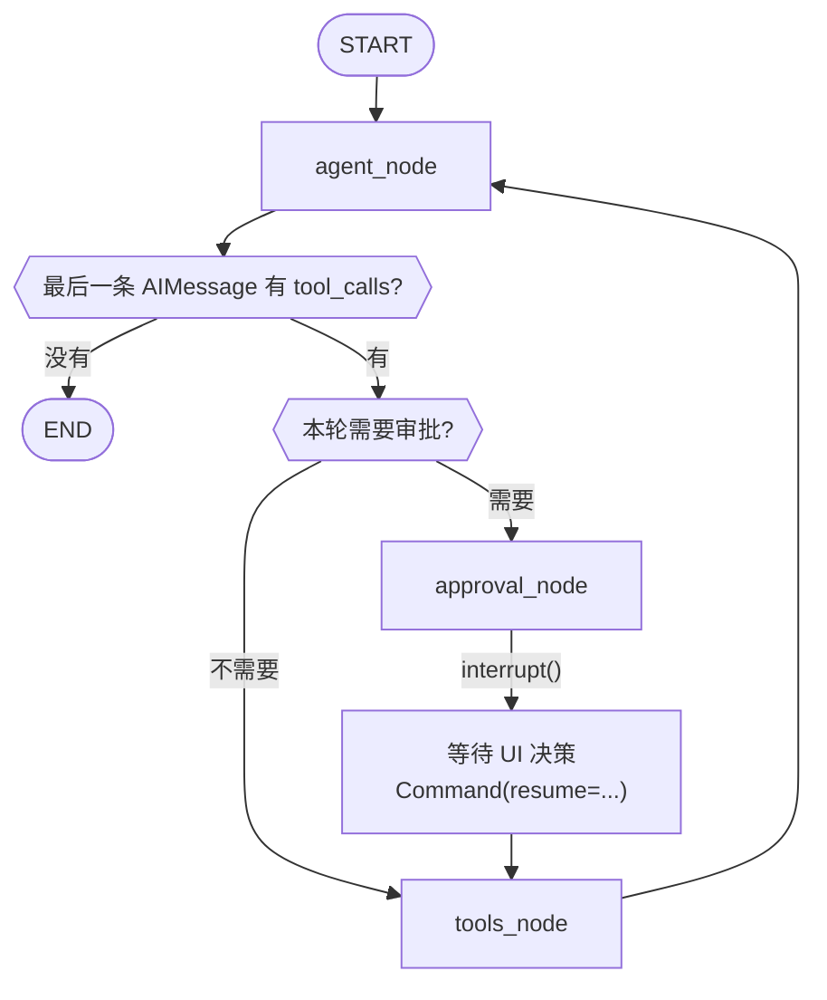
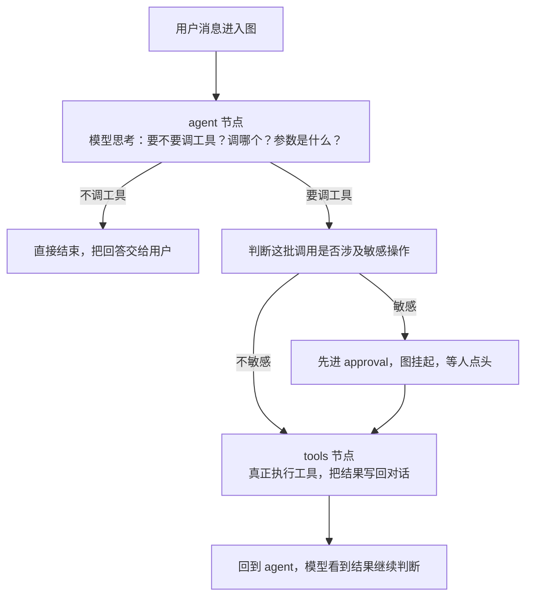
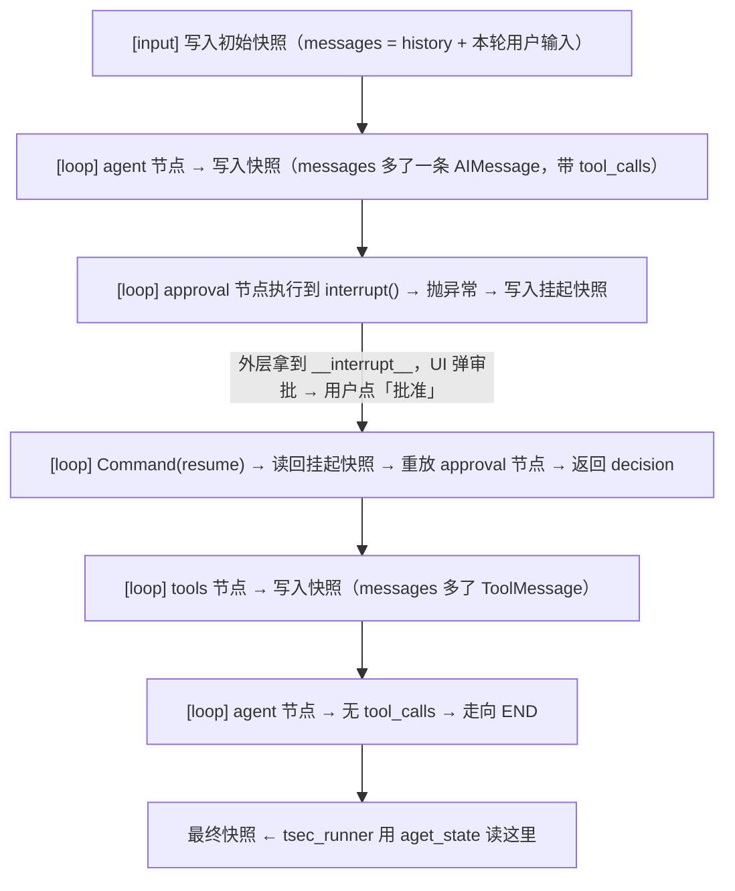
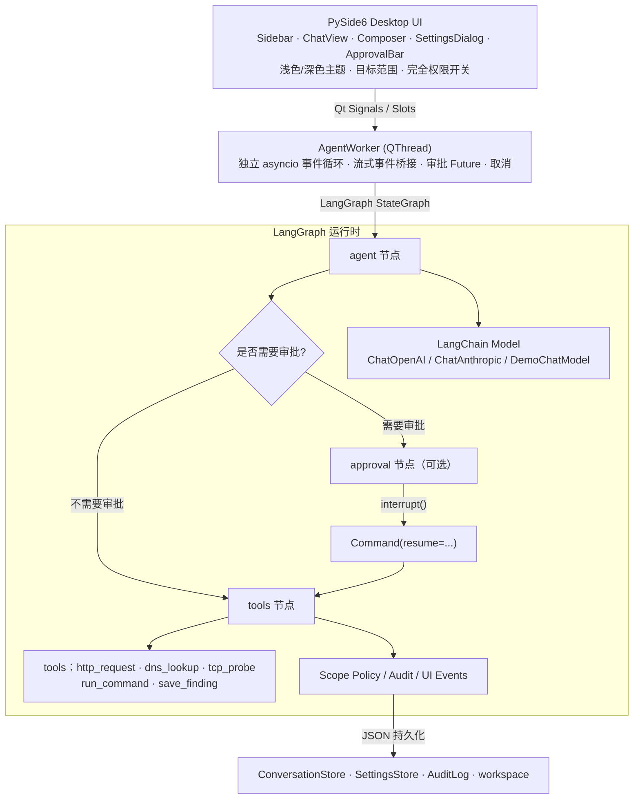
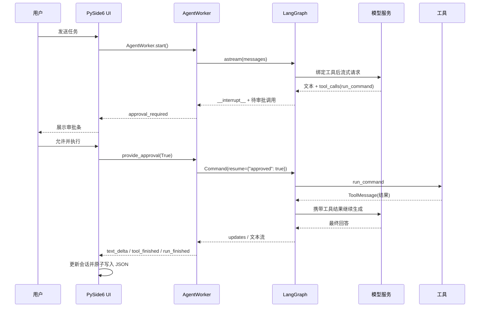
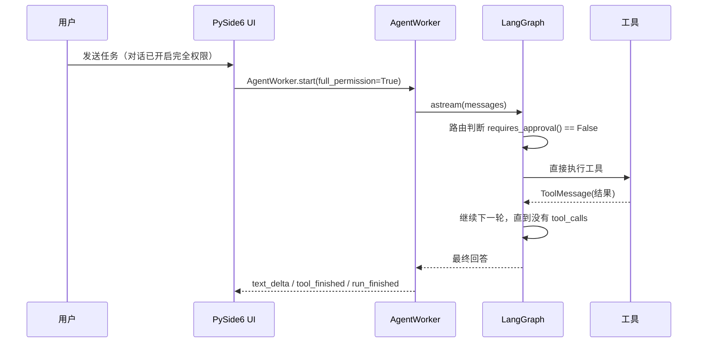

## 前言

> This is just a rough attempt; please excuse the quality.
>

本项目（SSsec v0.1.0）在 Tsecbench 平台的跑分测试结果如下：

**Tsecbench v1**：

综合得分 **55.7**  获得点数 **13750**  完成率 **59.5%**  答对Flag **44/74**

**排名：158名**



**bctf-2026**：

综合得分 **36.92**  获得点数 **8200**  完成率 **35.9%**  答对Flag **14/39**

**排名：50名**



**XBOW Validation Benchmarks**：

综合得分 **53**  获得点数 **15000**  完成率 **57.7%**  答对Flag **60/104**

**排名：23名**



**Cybench**：

综合得分 **18.27**  获得点数 **3800**  完成率 **20%**  答对Flag **8/40**

**排名：20名**




**总结：作为刚孵化的项目，跑分成绩属实不佳，但由于参与测试的攻防 Agent 并不多，排名还算看得过去。**

------


## 项目简介

> **SSsec** 是一个面向授权安全测试的本地桌面 AI Agent Harness。
> 界面使用 **PySide6**，Agent 运行时基于 **LangGraph + LangChain**，模型服务、对话、工具调用、权限策略与审计全部围绕桌面工作流设计。

**当前版本：v0.1.0（首个版本）**



---


## 技术架构

### LangGraph 状态机设计

#### 1. 状态定义

AgentState 只有两个字段：

```python
class AgentState(TypedDict, total=False):
    messages: Annotated[list[AnyMessage], add_messages]
    approval: dict[str, Any] | None
```

`messages` 用 LangGraph 的 `add_messages` reducer，节点返回的消息会**追加**而不是覆盖，并自动按消息 ID 去重/合并。

`approval` 没有 reducer，节点返回即覆盖；`tools_node` 执行完会把它清空，避免影响下一轮。


#### 2. 图拓扑



浅浅翻译一下：

一次用户提问，在 LangGraph 里实际是这样流动的：



这里面有设计三个节点（agent_node \ approval_node \ tools_node），而三个节点各自负责流程中的**一个阶段**。


#### 3. 三个节点职责

**agent 节点**（agent_node）

一次循环的起点，也是每次工具执行后的回流点。

它负责把系统提示词 + 整段对话历史交给模型；然后流式接收模型的输出，一边接收一边把文字和思考过程推给界面；再把流式片段拼成一条完整的 AI 消息；最后从这条消息里读出模型的意图（纯回答，还是要调工具、调哪几个、参数是什么）。

**产出：** 它会生成一条完整的 AI 消息，携带工具调用的请求或者最终回答。


**approval 节点** （approval_node）

生效时刻：模型要调工具，且这批调用里有敏感操作。最直观的体现就是当你发布任务的时候，大模型会思考一下，然后界面会弹出 “将要**，请你确认” 的弹窗，然后一般情况下你都会点确认。而把这个弹窗带到你面前的操作，就是靠这个 approval_node 节点。

它会把本轮要调的工具整理成人类可读的清单：工具名、参数、是否需要确认；并且主动让整个图停下来，把清单抛给界面，进入等待状态；最后用户点批准或拒绝后，图从这个断点恢复，决策结果被带回流程里。

**产出：** 得到审批结论后，存在状态里，供下一个节点读取。也是整个 Agent 里唯一会让人工介入的环节。


**tools 节点**（tools_node）

审批通过后，或者本来就不需要审批时,会进入到这个节点

先读取审批结论，先判断这一轮是否被拒绝；如果被拒绝，则不会调用工具；如果放行，则逐个执行工具，拿到结果；对结果做截断、判断成功/失败；把每个工具的结果包装成一条工具消息，追加回对话历史。

**产出：** 把工具调用后的结果作为模型下一轮思考的输入


| 节点     | 角色 | 输入                | 输出                 | 失败/异常时                |
| :------- | :--- | :------------------ | :------------------- | :------------------------- |
| agent    | 决策 | 系统提示词 + 历史   | 回答，或工具调用请求 | 模型无输出则报错结束       |
| approval | 闸门 | 工具调用清单        | 批准/拒绝结论        | 用户拒绝则整轮作废         |
| tools    | 执行 | 审批结论 + 调用请求 | 工具结果消息         | 单个工具失败只影响该条结果 |

所以这个流程上有三个关键点：

1. 图自身的循环由 “最后一条 AIMessage 是否还有 tool_calls” 决定。因此在agent_node节点，它每产出一条带工具调用的消息，循环就继续；产出一条不带工具调用的消息，循环就结束。然后该循环多少次呢？这个就写在代码里了：外层设 `recursion_limit = max(10, max_tool_rounds * 3 + 4)`，`max_tool_rounds` 默认 8，这样最多约 8 轮循环，也防止了模型无限调用。
2. approval_node是可选旁路，不是每次工具调用都经过它，只有敏感操作才插入这一段。
3. tools 是唯一会产生副作用的地方（会与外部世界建立连接），所有网络请求、命令执行、发现记录等行为都发生在这一步。


#### 4. Checkpointer

Checkpointer同样也扮演着非常主要的角色。说简单点，就是“存档点”，负责记录一次运行内图的状态推进。

因为上面有涉及到 **approval 节点**（人工审批操作），会导致任务运行期间，图暂停。

而Checkpointer就是图能够 “暂停并继续” 的前提条件。

说的官方一点：Checkpointer 是 LangGraph 的**状态快照存储器**。图每推进一步（一个 superstep），它就把当时的完整状态按 `thread_id` 存一份；之后可以用同一份快照恢复、读取、回滚。解决了 “图运行在内存里，停下来，状态就丢失” 的问题。没有它，`interrupt()` 无法工作。官方实现里也明确要求：要使用 interrupt，必须启用 checkpointer，因为该特性依赖持久化的图状态。

概念性的东西就不多讲了，讲讲它在本项目的具体使用：


**一次运行的 checkpoint 时序**




**一次运行中的流程位置**

运行开始前：建立一条独立的时间线。每次用户点击发送时，系统都会为这一次运行分配一个全新的标识。这个标识只属于本次运行，不与上一轮共享。

每个阶段结束时：保存一份快照。图的执行是分阶段推进的，每完成一个阶段，系统都会自动保存一份完整的状态快照。（初始输入 → 模型第一次决策 → 挂起 → 恢复 → 工具执行结果 → 模型第二次决策 → 结束）

遇到审批时：暂停，但不丢失。这是 Checkpointer 在这个项目里的必要点。模型决定调用敏感工具时，审批节点会主动让图暂停；**在暂停的瞬间，当前状态被完整记录**；然后控制权交回界面，等待用户点击按钮；在用户批准或拒绝后，图会**根据记录下来的位置继续**，而不是从头重新运行。**如果没有 Checkpointer**：图一旦暂停，状态就会随之消失（用户点击“批准”后，系统无法知道刚才要干什么），导致这个功能无法工作。

恢复时：从暂停点重新执行。被暂停的那个阶段会被重新执行一遍，不是从暂停语句的下一行继续。因此，本项目把所有会产生实际影响的操作，比如弹出审批框、写审计日志，都放在图的外层，而不是放在暂停的那个节点内部。

运行结束时：随对象一起被回收。


### LangChain

LangChain 在这个项目里承担的是协议层：定义模型、消息、工具这三种东西的标准形态，提供流式 chunk 聚合、工具调用结构化、消息序列化这些底层能力。而具体的编排由 LangGraph 承担。

#### 1. 消息协议

项目所有跨模块传递的“对话内容”，都用 LangChain 的消息类型表示：

- `SystemMessage`：系统提示词
- `HumanMessage`：用户输入
- `AIMessage`：模型输出，可能携带 `tool_calls`
- `ToolMessage`：工具执行结果，必须带 `tool_call_id`
- `AnyMessage`：以上联合类型，用于状态标注

#### 2. 模型抽象

`BaseChatModel` 是这里的关键抽象。项目实现了三种来源：

| 来源                                                   | 实现方式                                     |
| :----------------------------------------------------- | :------------------------------------------- |
| OpenAI 兼容（DeepSeek、Qwen、Ollama、vLLM、LM Studio） | `ChatOpenAI` + 自定义 `base_url`             |
| Anthropic                                              | `ChatAnthropic`                              |
| 离线演示                                               | 自定义 `DemoChatModel`，继承 `BaseChatModel` |

#### 3. 工具协议

`build_tools` 里每个工具都用 `@tool("名字")` 装饰，返回 `list[BaseTool]`。

1. **函数签名 → 参数 schema**：类型注解（`url: str`、`ports: list[int]`）被转成 JSON Schema；
2. **docstring → 工具描述**：模型靠这段文字判断什么时候该用这个工具；
3. **返回值统一成字符串**：所有工具返回 JSON 字符串。

然后 `bind_tools(tools)` 把这些 schema 附加到模型请求里，模型就能返回结构化的 `tool_calls`。

#### 4. 流式聚合

```
模型流式吐出 N 个 chunk
   ↓ 每个 chunk：抽文本 → 推给 UI；抽推理 → 推给 UI
   ↓ 同时用 + 把所有 chunk 累加成一个聚合 chunk
   ↓ message_chunk_to_message(聚合 chunk)
   ↓ 得到一条完整的 AIMessage（含 tool_calls）
```

`message_chunk_to_message` 是 LangChain 提供的工具函数，把 `AIMessageChunk` 的增量结构（尤其是 `tool_calls` 的分片拼接）还原成完整的 `AIMessage`。

#### 5. 历史还原 

```
会话 JSON（业务模型）
   ↓ 用户消息 → HumanMessage
   ↓ assistant 文本段 → AIMessage
   ↓ 连续工具段 → AIMessage(tool_calls=[...]) + 若干 ToolMessage
   ↓ 截断超长结果（6000 字符）
   ↓ 保证首条是 HumanMessage
LangChain 消息列表 → 作为下一轮图输入
```


### 工具层

| 工具           | 作用                   | 必需参数                           | 默认审批（敏感模式）                 | 严格范围模式                 |
| -------------- | ---------------------- | ---------------------------------- | ------------------------------------ | ---------------------------- |
| `http_request` | 发起 HTTP 请求         | `url`                              | GET/HEAD/OPTIONS 否；其他方法 **是** | 范围外拒绝，重定向逐跳校验   |
| `dns_lookup`   | DNS 查询               | `host`                             | 否                                   | 范围外拒绝                   |
| `tcp_probe`    | TCP 连接探测           | `host`, `ports`                    | 否                                   | 范围外拒绝                   |
| `run_command`  | PowerShell / bash 命令 | `command`                          | **是**                               | 不适用（命令无法按主机校验） |
| `save_finding` | 记录测试发现           | `title`, `severity`, `description` | 否                                   | 不适用                       |

#### 1. http_request （HTTP探测）

```
http_request(url, method="GET", headers=None, body=None)
```

- `url`：必须 http/https，否则直接拒绝；
- `method`：白名单 `GET / HEAD / POST / PUT / PATCH / DELETE / OPTIONS`，其余一律拒绝；
- `headers`：必须是字符串键值对象，值会被强制转成字符串；
- `body`：字符串，`GET/HEAD` 会被强制置空。

**执行流程**

1. 方法与 URL 校验：方法必须属于白名单，URL 必须是 http/https。
2. 范围检查：按当前范围策略判断目标是否允许访问；严格模式下，范围外直接拒绝。
3. 合并请求头：先放入固定的默认头，再合并调用方传入的自定义头。
4. Host 头单独校验：如果自定义头里有 Host，把它当作独立目标再检查一次，防止用 Host 指向同一 IP 上未授权的虚拟主机。
5. 手动处理重定向：关闭自动跟随，自己逐跳处理；每一跳都重新校验范围，跨主机跳转时主动剥离凭据类请求头（认证、Cookie、代理认证、Host），避免凭据泄露给另一台主机；符合 HTTP 语义时降级为 GET 并丢弃请求体。
6. 流式读取响应体：边读边计数，超过字节上限就停止；解码后再按字符数截断，任一截断都打标记。
7. 整理结果：返回状态码、原因短语、过滤后的响应头、截断后的响应体、走过的重定向链，以及本次的范围匹配信息。

**返回结构**

成功时返回一个信息量很大的 JSON：

```
ok, url, method, status_code, reason,
headers, body, body_truncated,
redirects（走过的每一跳）,
scope_matched, scope_mode, scope_warning
```

**在渗透流程中的作用**

拿到目标应用层内容

#### 2. dns_lookup（DNS 查询）

```
dns_lookup(host, record_type="A")
```

支持 9 种记录：`A / AAAA / CNAME / MX / TXT / NS / SOA / CAA / PTR`。

| 记录     | 渗透价值                                          |
| :------- | :------------------------------------------------ |
| A / AAAA | 解析地址、判断 CDN、IPv6 暴露面                   |
| CNAME    | 找真实源站（CNAME 指向源 IP 是经典绕过 CDN 手法） |
| MX       | 邮件网关、邮件安全测试入口                        |
| TXT      | SPF/DKIM 配置、第三方验证记录、可能泄露内部信息   |
| NS       | 托管商、子域接管风险                              |
| SOA      | 域名管理信息、区域负责人邮箱                      |
| CAA      | 证书签发策略                                      |
| PTR      | 反向解析、内网主机识别                            |

**在渗透流程中的作用**

确认目标是否真实存在、解析到哪里；通过 CNAME 判断是否走 CDN，为后续绕过做准备；通过 TXT 发现 SPF 配置问题、第三方服务绑定；通过 NS/SOA 判断托管环境。

#### 3. tcp_probe（端口探测）

```
tcp_probe(host, ports, timeout_ms=1200)
```

五种结果状态

| 状态        | 含义                      | 对模型的意义       |
| :---------- | :------------------------ | :----------------- |
| `open`      | 连接成功，带 `latency_ms` | 服务存在           |
| `closed`    | 连接被拒绝                | 主机活着但端口未开 |
| `timeout`   | 超时                      | 可能被防火墙丢弃   |
| `dns_error` | 域名解析失败              | 目标地址有问题     |
| `error`     | 其他 OS 错误              | 需看 error 字段    |

**在渗透流程中的作用**

确认目标存活；发现非标准端口上的服务（管理后台、数据库、调试端口）。

#### 4. run_command（命令执行）

```
run_command(command)
```

Windows：

- 优先 `powershell.exe`，其次 `pwsh.exe`；
- 参数 `-NoLogo -NoProfile -NonInteractive -Command`；
- 命令前注入 UTF-8 输出设置（`[Console]::OutputEncoding`），避免中文乱码；
- `CREATE_NO_WINDOW` 防止弹黑窗。

其他平台：`/bin/bash -lc`。

工作目录：`ctx.workspace`。

**在渗透流程中的作用**

写循环脚本、调用系统自带工具（如 `curl`、`nmap`）等。

#### 5. save_finding（记录发现）

```
save_finding(title, severity, description, target="", evidence="")
```

**在渗透流程中的作用**

把发现到的漏洞记录下来

------


## 技术栈

| 层         | 技术                                                         |
| ---------- | ------------------------------------------------------------ |
| 桌面界面   | PySide6（Qt Widgets）                                        |
| Agent 编排 | LangGraph `StateGraph` + `interrupt()` / `Command(resume=...)` |
| 模型抽象   | LangChain `BaseChatModel`、`ChatOpenAI`、`ChatAnthropic`     |
| 工具定义   | LangChain `BaseTool` / `@tool`                               |
| HTTP / DNS | httpx、dnspython                                             |
| 配置与密钥 | 本地 JSON + Windows DPAPI                                    |
| 打包       | PyInstaller（one-folder）                                    |

### 分层图示



### 一次带审批的调用（标准模式）



### 一次完全权限调用




**注：UI 层非项目核心，不做过多阐述**


## 结语

从10月份开始打算做 AI 安全的时候，我就在纠结要从哪个分支开始——**AI for Security** or **Security for AI**。思虑再三后还是决定先设计一款 **Pentest Agent**（AI for Security）。其实改变学习路线是一件很艰难的事情，从去年冬天腾讯举办第一届智能攻防挑战赛开始，我就一直在关注这条赛道，犹豫再三，迟迟未行动。对于那时的我而言，补充完传统安全的技术栈，尽早进入安全大厂实习才是优先级最高的事。

我不知道攻防Agent会不会是安全行业的机遇，投入自己的时间和精力在上面也许会导致南辕北辙的局面。我把它看做一场赌局，而我将把未来三个月的时间作为赌注。这半个月来，我都在学习 Agent 开发，包括 LangChain、LangGraph 这种主流框架，说实话我并没有吃的很透，完全是一个初学者的水平，包括这个项目涉及到的知识点也很浅。我找不到太多融合安全的 Agent 项目（保姆级的那种），只能依葫芦画瓢，像模像样的做着。

SSsec 的槽点还有很多，甚至称不上是一个合格的作品。但我也借此机会更新了自己的 github 和个人博客，在这条路上踩下了油门。
